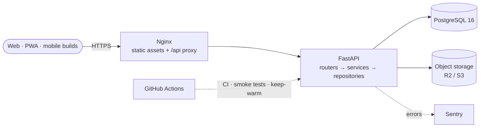
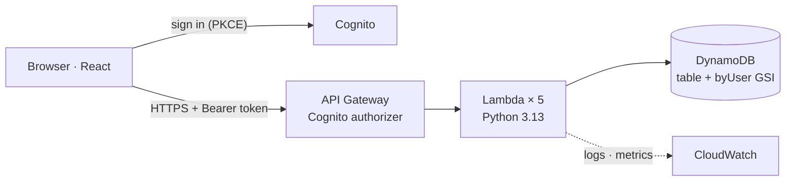
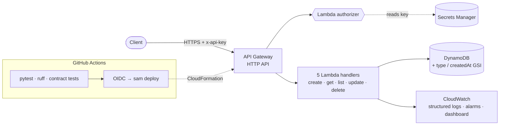
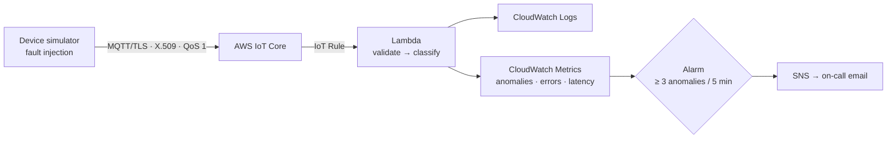
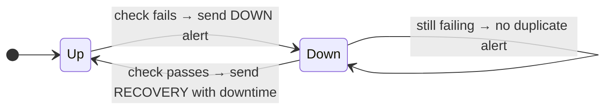
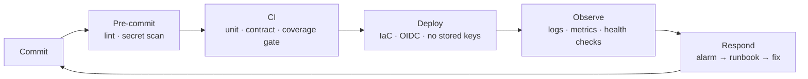

<picture>
  <source media="(prefers-color-scheme: dark)" srcset="https://raw.githubusercontent.com/Joun-Mikhail/Joun-Mikhail/main/assets/hero-dark.svg">
  
</picture>

  
  
  

I'm a **Cloud & IT Support Engineer** who builds and runs services on **AWS**. My projects are built the way production teams work: automated tests, CI/CD pipelines, infrastructure as code, least-privilege access, alarms that page someone, and written runbooks for when things break.

Based in **Brno, Czech Republic** · open to relocation across **Europe** · working languages **English** and **Arabic**.

> **Looking for:** IT Support Engineer · Cloud Support Engineer

<picture>
  <source media="(prefers-color-scheme: dark)" srcset="https://raw.githubusercontent.com/Joun-Mikhail/Joun-Mikhail/main/assets/metrics-dark.svg">
  
</picture>

## What I bring

| Area | What I can do for your team | Where to see it |
| :-- | :-- | :-- |
| **Cloud (AWS)** | Build and support serverless services with Lambda, API Gateway, DynamoDB, IoT Core, SNS and Secrets Manager, defined as infrastructure as code (SAM) | [Device Registry API](https://github.com/Joun-Mikhail/device-registry-serverless-api) · [IoT Monitoring](https://github.com/Joun-Mikhail/iot-monitoring-system) |
| **Monitoring & incident response** | CloudWatch metrics, alarms and dashboards, SNS alerting, health probes, uptime checks with down and recovery alerts, step-by-step debugging playbooks | [IoT failure playbook](https://github.com/Joun-Mikhail/iot-monitoring-system#failure-modes-and-debugging-playbook) · [Service Watchdog](https://github.com/Joun-Mikhail/service-watchdog) |
| **Automation & CI/CD** | GitHub Actions pipelines with tests, linting, coverage gates and secret scanning; keyless OIDC deploys to AWS; post-deploy production smoke tests | [CareerFlow workflows](https://github.com/Joun-Mikhail/careerflow/tree/main/.github/workflows) · [this profile](#live-repository-status) |
| **Security fundamentals** | Least-privilege IAM per function, API-key authorizer backed by Secrets Manager, JWT with refresh-token rotation, bcrypt, dependency and secret audits | [Device Registry security](https://github.com/Joun-Mikhail/device-registry-serverless-api#security) |
| **Backend & APIs** | REST APIs in Python (FastAPI), PostgreSQL schema design and migrations, contract tests against an OpenAPI spec | [CareerFlow](https://github.com/Joun-Mikhail/careerflow) |
| **Linux & containers** | Docker, Docker Compose, Nginx reverse proxy, shell scripting, troubleshooting from logs | [CareerFlow](https://github.com/Joun-Mikhail/careerflow) |

  <picture>
    <source media="(prefers-color-scheme: dark)" srcset="https://skillicons.dev/icons?i=aws,py,fastapi,postgres,docker,githubactions,linux,nginx,bash,git,react,ts&theme=dark">
    
  </picture>

## Featured projects

### [CareerFlow](https://github.com/Joun-Mikhail/careerflow) · full-stack job-search platform

A production-style SaaS app for running a job search: Kanban pipeline, interviews, offers, tasks, analytics, a document vault and AI-assisted CV tailoring. It runs on the web, installs as a PWA and builds for iOS and Android from one codebase.

- **Layered backend.** Routers handle HTTP, services hold business rules and authorization, repositories own all SQL. Migrations run through Alembic.
- **Operated, not just built.** A `/health` probe returns `503` when the database is down. It also has Sentry error monitoring, structured audit logs, post-deploy smoke tests and a keep-warm job against cold starts.
- **Quality gates.** Pytest, Vitest, Ruff, mypy, ESLint, Bandit and pip-audit run in CI.

<picture>
  <source media="(prefers-color-scheme: dark)" srcset="https://raw.githubusercontent.com/Joun-Mikhail/careerflow/main/docs/screenshots/dashboard-dark.png">
  
</picture>

<b>Architecture</b>

### [serverless-notes-api](https://github.com/Joun-Mikhail/serverless-notes-api) · secure notes API on AWS

Multi-user private notes app built the way real AWS workloads are built. Users sign in with Amazon Cognito (OAuth 2.0 + PKCE). Five Lambda handlers sit behind API Gateway. Each note is owned by one user — enforced atomically with DynamoDB conditional writes, not application code.

- **Security by design.** Least-privilege IAM: one DynamoDB action per Lambda. JWT scopes (`notes/read`, `notes/write`) validated at API Gateway. Uniform error responses prevent user enumeration.
- **Production-shaped ops.** Structured JSON logging, CloudWatch alarms, throttling, cursor pagination, optimistic locking, input validation at every layer.
- **Quality gates.** 193 tests (99% coverage), mypy strict, ruff, cfn-lint, sam validate, Playwright browser tests, axe accessibility audit — all in CI.
- **Deployed to AWS** (eu-north-1, 2026-11-17): 38/38 live API checks passed including authentication, isolation, CORS and throttling.

<picture>
  <source media="(prefers-color-scheme: dark)" srcset="https://raw.githubusercontent.com/Joun-Mikhail/serverless-notes-api/main/evidence/screenshots/08-notes-dark-1280.png">
  
</picture>

<b>Architecture</b>

### [Device Registry API](https://github.com/Joun-Mikhail/device-registry-serverless-api) · serverless REST API on AWS

The registry that tracks a fleet of connected devices: what each one is, where it is, and whether it works. Five Lambda handlers sit behind API Gateway, all defined in a single SAM template.

- **Deploys with no stored cloud credentials.** GitHub Actions assumes an AWS role through OIDC, then runs `sam deploy` to `eu-central-1`.
- **Query-first data access.** Filtered lists use a DynamoDB GSI `Query` instead of a `Scan`, with cursor pagination.
- **Strict access.** A Lambda authorizer checks an API key held in Secrets Manager, and each function gets only the DynamoDB actions it needs.
- **125 tests.** Unit, contract and integration tests run behind a 91% coverage gate, plus `ruff` and `detect-secrets` pre-commit hooks.

<b>Architecture</b>

### [IoT Monitoring System](https://github.com/Joun-Mikhail/iot-monitoring-system) · telemetry pipeline with alerting

Sensors publish over MQTT/TLS to AWS IoT Core. A Lambda function validates each reading, classifies anomalies and emits CloudWatch metrics. An alarm pages on-call through SNS.

- **Failure injection built in.** The device simulator can drop, corrupt, delay or silence messages, so the alerting path is exercised and not just assumed to work.
- **Ready for on-call.** The README includes a **debugging playbook** for each failure mode: missing invoke permissions, certificate errors, import errors and silent alarms.
- **Honest scope.** It is documented as a prototype, with its limitations and design tradeoffs written down (QoS 1 vs 2, direct metrics vs log filters).

<b>Architecture</b>

### [Service Watchdog](https://github.com/Joun-Mikhail/service-watchdog) · uptime monitor with alerting

A lightweight uptime monitor. It checks a list of endpoints on a schedule and emails once when a service goes down, without spamming on every failed check. When the service recovers, it sends a recovery notice with the total downtime.

<b>Alert logic</b>

## How I ship and operate

The loop I build into my projects: catch problems before merge, deploy without manual steps, and know about failures before users do.

## Live repository status

This board is generated by [a small Python script](scripts/render_status.py) that queries the GitHub API. A [scheduled GitHub Actions workflow](.github/workflows/status-board.yml) tests the script and redraws the board every day. The profile is a tiny pipeline of its own.

<picture>
  <source media="(prefers-color-scheme: dark)" srcset="https://raw.githubusercontent.com/Joun-Mikhail/Joun-Mikhail/output/status-dark.svg">
  
</picture>

 

<picture>
  <source media="(prefers-color-scheme: dark)" srcset="https://raw.githubusercontent.com/Joun-Mikhail/Joun-Mikhail/main/assets/footer-dark.svg">
  
</picture>

  <a href="https://linkedin.com/in/john-mikhaill1"><b>LinkedIn</b></a> ·
  <a href="mailto:mikhailjoun@gmail.com"><b>mikhailjoun@gmail.com</b></a> ·
  Brno, Czech Republic · open to EU relocation

